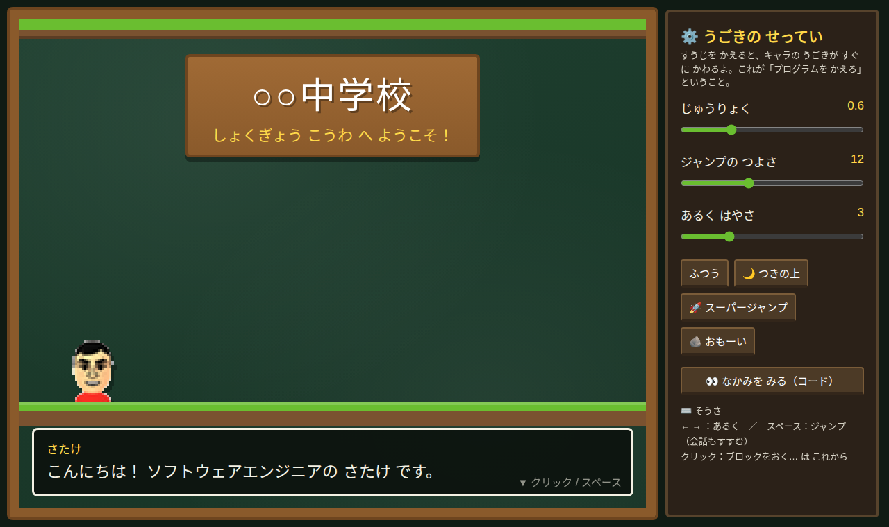

# Flatcraft

中学1年生向け職業講話（2027-01-20）のための、**2次元マインクラフト風**のオープニング黒板＆ミニワールド。PWA形式の静的アプリで、ビルド不要・依存ゼロ。

- 最初の数分は「動く黒板」でつかみと自己紹介（残りの講話は PowerPoint 等のスライドで進める）
- 右側の常設パネルで 重力 / ジャンプ / 速さ の値を書き換えると、キャラの動きがその場で変わる
- 「中身を見る」では、書き換えずにコード（命令）だけを見せる。パネルの値とコードの数字は連動して光る

## 表示サンプル



（看板に学校名は出ない設計。実際の画面を Chromium で撮影したもの）

## 動かし方（当日はワンクリック）

- **Windows：`start.bat` をダブルクリック**するだけ。ローカルサーバー（PowerShell標準機能、追加インストール不要）が最小化で起動し、ブラウザでアプリが開く。止めるときは、最小化されているサーバーのウィンドウを閉じる
- macOS / Linux：`start.sh` を実行する（python3 を使用）
- そのまま `index.html` をブラウザで開いても会話と動きは動く（フォントだけネット接続時にGoogle Fontsから取得、無くても代替フォントで表示）。ただしPWAのオフライン機能は動かないので、当日は `start.bat` を正とする
- デプロイ先に GitHub Pages は使わない（Freeプランでは Private リポジトリで使えないため）。当日はチェックアウトまたは zip でローカルに持ち込み、localhost で動かす（`docs/decisions.md` 参照）

## 当日設定

話者は `index.html` 先頭の `CONFIG` の1箇所だけを変更する。学校名は看板にも台詞にも出さない設計なので、どの学校でも変更なしで使える。

```js
const CONFIG = {
  speakerName: "佐竹",
  speakerJob: "ソフトウェアエンジニア"
};
```

## 構成

| ファイル | 内容 |
|---|---|
| `index.html` | 本体（黒板・会話窓・物理・パネル・コード表示を1ファイルに） |
| `assets/mii.svg` | 話者のMii（GitHubプロフィール画像）を28×28ドットに落としたSVG |
| `assets/icon.svg` | 草ブロック風アイコン |
| `manifest.webmanifest` / `sw.js` | PWA（オフライン動作） |
| `docs/talk-flow.md` | 講話30分×2セットの流れ（構成案v1） |
| `docs/decisions.md` | 決定事項の記録 |

## 方針

- **Private リポジトリ**（学校名を含む資料のため）
- **CodeRabbit は Off**（`.coderabbit.yaml` で自動レビュー無効。サクサク作る）
- **GitHub Actions は使わない**（ビルド不要の静的アプリのため不要）
- 本物のMinecraftの素材・フォントは使わない。雰囲気のみを寄せ、書体は無償のドット書体（DotGothic16）を使う

## アバター画像について

原本のPNG（84×84）はバイナリのため、GitHubコネクタのテキスト専用pushでは送れない。リポジトリにはSVG版（`assets/mii.svg`）を入れてある。PNG版が必要な場合は `assets/mii.png` としてWeb UIからアップロードする。
